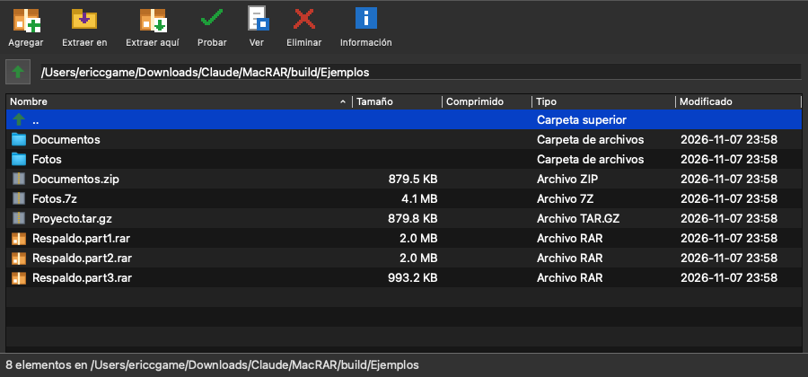
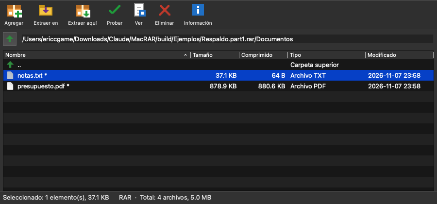

# MacRAR

Interfaz gráfica para **comprimir y extraer archivos en macOS**: RAR, 7z, ZIP, tar.gz y más.
Está escrita en Python con PySide6 (Qt) y usa por debajo los programas de línea de comandos `rar`, `7zz`
(7-Zip) y `bsdtar`.





## Funciones

- **Explorador de carpetas y de archivos comprimidos**: doble clic en un archivo comprimido para abrirlo y
  moverte por sus carpetas. Puedes ordenar por cualquier columna.
- **Extraer** todo o solo lo seleccionado ("Extraer en…" o "Extraer aquí"), con opciones para sobrescribir,
  omitir o renombrar.
- **Contraseñas**: se piden en una ventana. Si son incorrectas, se vuelven a pedir. Funciona también con
  archivos que tienen los nombres cifrados.
- **Progreso**: barra con porcentaje, archivo actual, volumen actual, tiempo transcurrido y restante, y botón
  Cancelar.
- **Archivos divididos en partes** (`.part1.rar`, `.001`, `.z01`…): aunque abras la parte 3, empieza desde la
  primera.
- **Crear** archivos RAR, 7Z o ZIP con nivel de compresión, división en partes, contraseña y cifrado de
  nombres.
- **Probar** la integridad, **Ver** un archivo sin extraer todo, **Eliminar** y **Agregar** archivos dentro de
  un archivo comprimido.
- **Arrastrar y soltar** sobre la ventana. Un archivo comprimido se abre; otros archivos o carpetas se
  comprimen.
- **Errores en español** (volumen faltante, contraseña incorrecta, archivo dañado…) y registro completo.

## Formatos

| Formato | Programa que se usa | Contraseña | Porcentaje |
|---|---|---|---|
| RAR (`.rar`, `.partN.rar`, `.r00`) | `rar` (o 7-Zip si no tienes `rar`) | Sí | Real |
| 7z, ZIP, ISO, GZ, BZ2, XZ, CAB… y partes `.001` | `7zz` (7-Zip) | Sí, incluidos ZIP AES y 7z con nombres cifrados | Real |
| tar, tar.gz, tgz, tar.bz2, tar.xz | `bsdtar` (viene con macOS) | No existe en este formato | Calculado por tamaño |

## Instalación

### 1. Python

MacRAR usa el Python que trae macOS (`/usr/bin/python3`). Si al ejecutarlo te pide instalar las
"Command Line Tools", acepta, o ejecuta:

```bash
xcode-select --install
```

### 2. PySide6

```bash
/usr/bin/python3 -m pip install --user PySide6
```

Se usa PySide6 y no Tkinter porque el Tk que trae el Python de Apple se cierra al arrancar en macOS 15.

### 3. 7-Zip (gratis)

1. Descarga la versión **"7-Zip for macOS: console version"** de <https://www.7-zip.org/download.html>.
2. Descomprímela.
3. Copia el archivo `7zz` en `/Applications/7zip/`:

```bash
mkdir -p /Applications/7zip && cp 7zz /Applications/7zip/ && xattr -c /Applications/7zip/7zz
```

> En Mac Intel puede hacer falta el paquete `mac-x64` si el universal no funciona: el error sería
> `bad CPU type in executable`.

### 4. RAR (opcional)

Descarga **"RAR for macOS"** de <https://www.rarlab.com/download.htm> y descomprímelo en `/Applications/rar/`
(el ejecutable debe quedar en `/Applications/rar/rar`). Sin `rar`, MacRAR **extrae** RAR con 7-Zip, pero no
puede **crear** archivos RAR. Lee la sección de licencias: RAR no es gratis.

MacRAR busca los programas en `/Applications/rar/`, `/Applications/7zip/`, `/usr/local/bin` y
`/opt/homebrew/bin`, y después en el `PATH`.

## Uso

```bash
/usr/bin/python3 macrar.py
```

También puedes abrir algo directamente con `/usr/bin/python3 macrar.py archivo.7z` o con
`/usr/bin/python3 macrar.py ~/Downloads`.

## Crear la app (MacRAR.app)

```bash
./build_app.sh
```

El script crea `dist/MacRAR.app`, que puedes arrastrar a **Aplicaciones**. Después:

- **Doble clic** abre MacRAR.
- **Soltar** un archivo comprimido sobre el icono lo abre.
- **Clic derecho → Abrir con → MacRAR** funciona en RAR, 7z, zip, tar, gz, iso, etc.
- Para que un tipo de archivo se abra siempre con MacRAR: selecciónalo → ⌘I → "Abrir con: MacRAR" →
  "Cambiar todo".

Qué hace el script:

1. Compila `app/launcher.applescript` en una app con `osacompile`. Es un lanzador que recibe los archivos que
   abres con la app y ejecuta `/usr/bin/python3 macrar.py <archivo>`.
2. Copia `macrar.py` dentro de la app (`Contents/Resources`), así que la app no depende de dónde tengas el
   repositorio.
3. Genera el icono con `app/make_icon.py` (dibuja la caja de `macrar.py`) y lo convierte con `iconutil`.
4. Ajusta el `Info.plist` (nombre, identificador y tipos de archivo) y firma la app localmente (`codesign -s -`).

Si la app no abre, revisa el registro en `~/Library/Logs/MacRAR.log`. Si cambias `macrar.py`, vuelve a
ejecutar `./build_app.sh`.

> En el Dock la ventana aparece como "Python", porque la app lanza el Python del sistema.

## Cómo funciona

Todo está en un solo archivo, `macrar.py`:

- **Motores** (`RarEngine`, `SevenZipEngine`, `TarEngine`): cada uno sabe listar, extraer, probar, eliminar,
  agregar y crear con su programa. `engine_for()` elige el motor según la extensión.
- **Listado**: `rar lt -v` y `7zz l -slt` dan un listado técnico que se convierte en un árbol de carpetas. tar
  se lee con el módulo `tarfile` de Python.
- **Progreso**: el programa se ejecuta con `QProcess` y su salida se lee mientras llega. `rar` y `7zz` reescriben
  el porcentaje con caracteres de retroceso (`\b`), así que la salida se parte por `\b` para leer cada
  porcentaje y cada nombre de archivo (`ToolOutput`). `bsdtar` no informa porcentaje: se calcula sumando el
  tamaño de cada archivo que va extrayendo.
- **Contraseñas**: nunca se deja que el programa la pida por teclado (con `rar` se pasa `-p-`, y `7zz` recibe
  una entrada vacía). Si la salida dice "Incorrect password", "Wrong password" o "Enter password", MacRAR pide
  la contraseña en una ventana y repite la operación. Las contraseñas correctas se recuerdan mientras la
  ventana esté abierta y no se guardan en disco.

## Limitaciones

- tar/tar.gz: no tienen contraseña y no se pueden modificar. Si extraes un tar.gz sin abrirlo antes, se muestra
  una barra de actividad en vez del porcentaje.
- 7z/ZIP: al extraer una selección desde una subcarpeta se conserva la ruta completa. Lo que agregues a un 7z o
  ZIP abierto va a la raíz.
- Los archivos divididos en partes no se pueden modificar (agregar o eliminar).
- La contraseña se pasa como argumento al programa (`-p…`), así que otros procesos del mismo usuario podrían
  verla mientras dura la operación.

## ¿Es gratis? Licencias

**MacRAR** es software libre con [licencia MIT](LICENSE): puedes usarlo, modificarlo y compartirlo, también en
proyectos comerciales, siempre que conserves el aviso de copyright.

MacRAR **no incluye ni redistribuye** ninguno de los programas que usa: cada persona los instala por su cuenta.
Sus licencias:

| Componente | Licencia | ¿Gratis? |
|---|---|---|
| [Python](https://www.python.org) | PSF License | Sí |
| [PySide6 / Qt for Python](https://doc.qt.io/qtforpython-6/) | LGPL v3 (también GPL y comercial) | Sí. Usarlo con `import` desde un programa MIT está permitido. Si algún día empaquetas Qt/PySide6 dentro de la app, tendrás que cumplir la LGPL v3 (incluir su licencia y permitir sustituir la biblioteca). |
| [7-Zip](https://www.7-zip.org/license.txt) (`7zz`) | GNU LGPL 2.1+, con partes BSD y la restricción de unRAR | Sí, también para uso comercial |
| [RAR para macOS](https://www.rarlab.com) (`rar`) | Shareware de RARLAB (win.rar GmbH) | **No**: es una versión de prueba de 40 días. Para seguir usándolo hay que comprar una licencia de RAR/WinRAR. `unrar` (solo extraer) es gratuito. |
| `bsdtar` ([libarchive](https://libarchive.org)) | BSD | Sí, viene con macOS |

**Para que todo sea gratis**, usa MacRAR sin `rar`: 7-Zip extrae los RAR (incluidos los que tienen contraseña y
los divididos en partes) y crea 7z y ZIP. Lo único que necesita `rar` con licencia es **crear** archivos RAR.

## Iconos y marcas

- Los iconos de MacRAR (caja de cartón, caja gris con cremallera y los de la barra de herramientas) son
  **originales**: están dibujados con código en `macrar.py` (`paint_icon`) a partir de rectángulos de colores.
  No se copió ninguna imagen de WinRAR ni de otro programa.
- Los iconos de carpeta y de documento de la lista son los del sistema, que macOS proporciona mientras la app
  se ejecuta. No se incluyen en el repositorio.
- *RAR* y *WinRAR* son marcas de win.rar GmbH. *7-Zip* es de Igor Pavlov. MacRAR es un proyecto independiente,
  sin relación con esas empresas ni respaldado por ellas. Las menciones a "RAR" describen el formato de archivo
  que la app abre.

*Esto es información general, no asesoría legal.*

## Licencia

[MIT](LICENSE) © 2026 EriccGame
